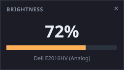

# Brightness Scroll

A tiny always-on-top widget for Windows 10/11 that changes your monitor's
brightness when you **roll the mouse wheel over it**.

## Quick start

Double-click **`Launch Brightness Scroll.bat`**.

Then move the pointer over the little dark card and roll the wheel.

## Controls

| Action | Result |
| --- | --- |
| Wheel up / down | Brightness +/- 5% (configurable) |
| **Shift** + wheel | Fine: +/- 1% |
| **Ctrl** + wheel | Coarse: +/- 10% |
| Drag the bar | Jump straight to a value |
| Double-click the % | Reset to 50% |
| Drag empty space | Move the widget (position is remembered) |
| Click the monitor name | Cycle: *all monitors* -> one monitor -> ... |
| Right-click | Menu (step size, rescan, run at login, exit) |
| Click the widget | Give it keyboard focus, so the keys below work |
| Arrow keys | +/- step *(after clicking the widget)* |
| PgUp / PgDn | +/- 10% *(after clicking the widget)* |
| Home / End | 0% / 100% *(after clicking the widget)* |

The widget sits at 88% opacity and snaps to 98% with a blue outline when you
point at it. **Scrolling never takes focus away from whatever you are working
in** - you can leave a browser, game or editor in front and just sweep the
pointer over the widget. Click the widget only if you want the arrow keys to
work.

## How it works

Two strategies, picked automatically:

1. **DDC/CI hardware brightness** (preferred) - the app talks to the monitor
   over the display cable using `dxva2.dll` and VCP feature `0x10`. This is the
   exact same setting the monitor's own on-screen buttons change, so it is
   stored *by the monitor* and survives reboots, driver restarts and logoff. It
   also works on most idle laptop panels.
2. **Software dimming** (fallback) - if no DDC/CI-capable display is found, the
   app rewrites the display's gamma ramp through `gdi32.dll`. This works on
   essentially any display, but it does **not** change the backlight: black
   stays slightly grey, it saves no power on an LCD, and it is reset if the
   graphics driver restarts.

The current source is shown in the right-click menu under
*"Brightness source: ..."*.

## Requirements

* Windows 10 or 11
* Python 3.8+ (**already installed on this machine**: Python 3.12.1)
* Nothing else - no `pip install`, no third-party packages, no admin rights

The launcher uses `pyw.exe`, so no console window ever appears.

## Command line

    pyw brightness_scroll.pyw                # normal use
    python brightness_scroll.pyw             # same, but keep a console for logs
    python brightness_scroll.pyw --selftest  # probe both backends, then exit
    python brightness_scroll.pyw --gamma     # force software dimming
    python brightness_scroll.pyw --step 2    # 2% per wheel notch
    python brightness_scroll.pyw --active 1  # control monitor #2 only
    python brightness_scroll.pyw --reset-config
    python brightness_scroll.pyw --x 100 --y 100

> Note: the filename ends in `.pyw`. Running it with `python` works fine; the
> `.pyw` extension is just what makes Windows launch it *without* a console.

## Run at login

Right-click the widget -> tick **Run at login**. This adds one value to

    HKEY_CURRENT_USER\Software\Microsoft\Windows\CurrentVersion\Run

Unticking it removes that value again. Both directions need no admin rights
and nothing else is touched.

## Files

| File | Purpose |
| --- | --- |
| `brightness_scroll.pyw` | The application (single file, stdlib only) |
| `Launch Brightness Scroll.bat` | Double-click launcher, no console window |
| `diagnose.py` | Read-only probe of what your hardware supports |
| `README.md` | This file |

Settings are stored in `%LOCALAPPDATA%\BrightnessScroll\config.json`
(window position, step size, selected monitor).

## Troubleshooting

**Nothing happens when I scroll.**
Run `python diagnose.py`. If it reports no DDC/CI monitor, the app has fallen
back to software dimming - the widget will say *"software (gamma ramp)"* in the
right-click menu. Software dimming also works, it just dims the picture
instead of the backlight.

**The % changes but the screen does not.**
DDC/CI is switched off in the monitor, or the cable cannot carry it. Open the
monitor's own on-screen menu and look for a **DDC/CI** entry (on a Dell it is
usually under *Others* or *Menu Settings*) and enable it. Then right-click the
widget -> **Rescan monitors**.

If your monitor is connected over **analog VGA**, DDC/CI works but is slow and
can be unreliable - the *write* direction is solid, but reading the current
value back can occasionally return a number that is a few percent off, which is
why the app samples reads and keeps the most common result. Once you touch the
wheel the displayed value is whatever you asked for, so it stays consistent.
**DisplayPort, HDMI, DVI and USB-C are all better.** On a laptop, an external
monitor over USB-C/Thunderbolt is usually the only display that accepts DDC/CI;
the internal panel may only support the gamma fallback.

**It is sluggish.**
DDC/CI is a low-speed serial link; some monitors need 100ms+ per change. The app
already coalesces a fast wheel flick into a single write, but a monitor that is
slow is simply slow. Lower the step size or use the bar to drag directly.

**The widget is in the way.**
Drag it anywhere - the position is remembered, including across restarts. Or
right-click -> *Exit* and start it again only when you need it.

**I want it gone completely.**
Right-click -> untick *Run at login* -> *Exit*, then delete the folder. Nothing
is written to the registry or filesystem other than the Run value above and
`%LOCALAPPDATA%\BrightnessScroll\config.json`.
